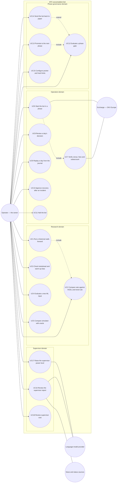

# Use case diagram — btc-accumulation — operator goals

> **Feature**: BTC sats-accumulation bot (issue #15)
> **Source specs**: [`docs/requirements/btc-accumulation.md`](../../../requirements/btc-accumulation.md) R01–R40
> **Related ADRs**: none yet (R40 is recorded in the requirements)
> **Decisions captured**: R40 (own engine + oracle), R21/R22 (supervisor levels), R28 (phase ramp-up)

## Context

Who wants what from the bot. Actors are the people and external systems that interact with the
product; the daily decision loop itself is not a use case (nobody initiates it each day, the
operator starts the bot and the loop runs inside it, see `02a-sequence-daily-decision.md`).
Structure (engine, exchange port, supervisor) lives in `03-component.md`, never here.

## Diagram

## Notes

| UC | Goal (verb + observable outcome) | Requirements | Status |
| --- | --- | --- | --- |
| UC1 | Run a purged walk-forward and obtain a sats report | R26, R31–R35 | planned (only a buy-and-hold engine exists) |
| UC2 | Compare the result in sats, net of fees, with HODL and R12 | R02, R03, R12 | planned |
| UC3 | Check that signals do not use the future nor depend on warm-up length | R31 | planned (CI gate) |
| UC4 | Add one ML input and keep it only if walk-forward sats improve | R14, R15 | planned |
| UC5 | Replay R12 in the oracle and read the gap against the simulator | R40 | planned (dev/CI only) |
| UC6 | Start the bot in paper or live mode for the current phase | R05, R17, R19, R27, R28 | planned (legacy `scripts/run.py` is KuCoin) |
| UC7 | Verify fee cap, instrument and absence of derivatives (include of UC6) | R17, R20 | planned |
| UC8 | Read why the bot acted or stayed put on a given day | R29 | planned |
| UC9 | Re-run a past day from its journaled inputs and compare | R29, R27 | planned |
| UC10 | Approve resuming after a fail-closed pause | R16c | planned |
| UC11 | Stop all trading at once | R16c, R20 | planned |
| UC12 | Check a phase's pass criteria against measured evidence | R26–R28 | planned |
| UC13 | Move the bot to the next phase or pocket step | R04, R05, R28 | planned |
| UC14 | Return the bot to paper when stop criteria are met (extends UC12) | R28 | planned |
| UC15 | Set pocket fraction, max orders per day, max order size | R04, R06 | planned |
| UC16 | Read supervisor opinions with their exact inputs and the counterfactual portfolio | R21, R36, R38 | planned |
| UC17 | Allow delay/reduce (level 2) or pause (level 3) after forward proof | R22, R37, R38 | planned |
| UC18 | Check monthly cost against the 10 € cap | R24 | planned |

- Not use cases (system events, see sequences): the daily decision, the buy-back stop (R16), the depeg
  controller (R16d), supervisor triage (R23), fail-closed pause (R16c).
- Time is a trigger, not an actor. The exchange and news sources are secondary actors only.
- Open: whether UC11 (halt) also liquidates to BTC is decided in `05a-state-pocket.md`.
