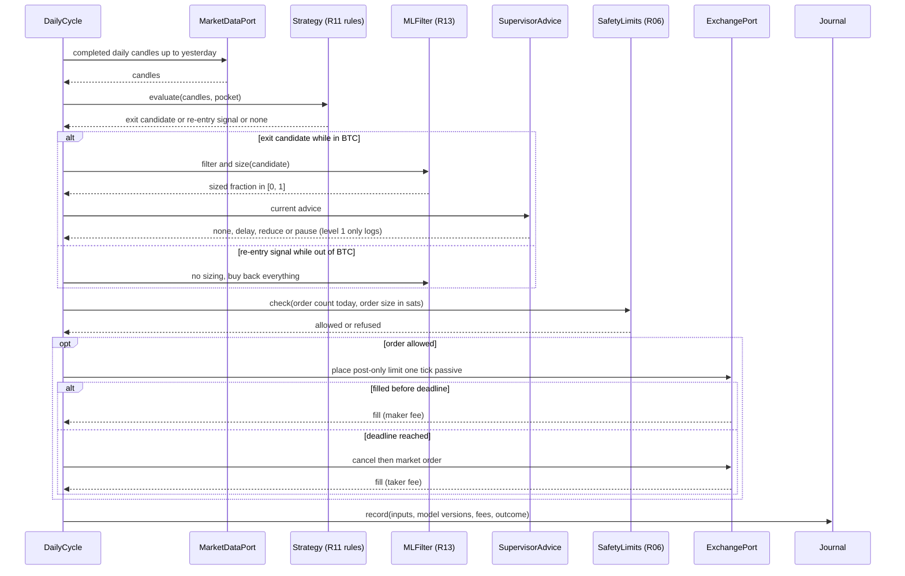

# Sequence diagram — btc-accumulation — daily decision cycle

> **Feature**: BTC sats-accumulation bot (issue #15)
> **Source specs**: requirements R10–R13, R16, R18, R22, R29, R32
> **Related ADRs**: none yet
> **Decisions captured**: R32 one code path for backtest, paper and live

## Context

One daily cycle on a completed daily candle, from data to journaled outcome. The same cycle runs in
backtest, paper and live: only the exchange port implementation changes (R32). Does not cover
incidents (`02b`) nor how supervisor advice is produced (`02c`).

## Diagram

## Notes

- A sized exit is a tranche (R16): its volume-weighted exit price starts the 5 % buy-back stop, handled in `02b`.
- The supervisor never sells nor starts a trade (R22): its advice can only delay or reduce an exit.
- Post-only orders rest at least one tick on the passive side, otherwise OKX rejects them as taker (requirements, open points).
- The journal record is written whether or not an order was placed, so any day can be replayed (R29).
- Decided (owner, 2026-10-23): the R16 stop is checked on intraday price polls, not on the daily close (see `02b`).
