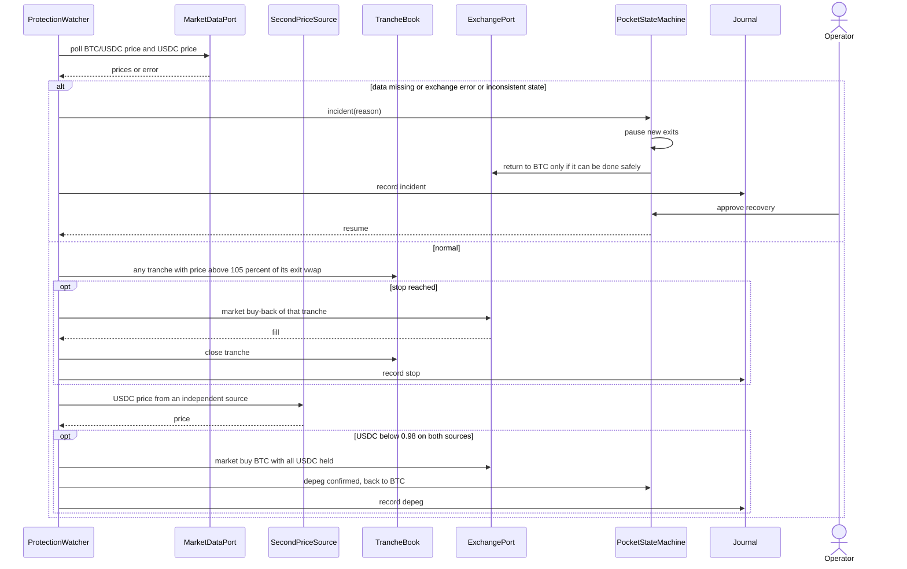

# Sequence diagram — btc-accumulation — buy-back stop, depeg and fail-closed incident

> **Feature**: BTC sats-accumulation bot (issue #15)
> **Source specs**: requirements R16, R16b, R16c, R16d, R20, R37
> **Related ADRs**: none yet
> **Decisions captured**: R16d deterministic depeg controller, supervisor can only pause (R22)

## Context

The three deterministic protections that run independently of strategy and of the language model:
the 5 % buy-back stop per exited tranche, the stablecoin depeg controller and the fail-closed incident
handler. Does not cover the supervisor's own pause (`02c`).

## Diagram

## Notes

- No performance pause exists (R16b): the only pauses are incidents (R16c), depeg (R16d) and supervisor pauses (R37).
- The depeg controller and the stop use no language model and no external text.
- Before each order the instrument is checked as BTC/USDC spot and the account as free of derivatives positions (R20), otherwise the bot halts.
- Decided (owner, 2026-10-23): the stop is evaluated on every intraday poll, so the backtest needs intraday data (also needed by R33). The polling interval itself is set at implementation.
