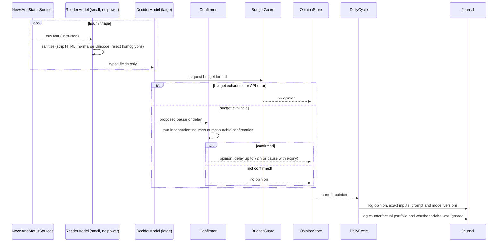

# Sequence diagram — btc-accumulation — supervisor advice pipeline

> **Feature**: BTC sats-accumulation bot (issue #15)
> **Source specs**: requirements R21–R25, R36–R39
> **Related ADRs**: none yet
> **Decisions captured**: reading and deciding are separated (R36)

## Context

How an opinion is produced from untrusted text and reaches the decision cycle. The pipeline runs
beside the engine and communicates only through a stored, typed opinion. At level 1 (observation, R21)
the cycle logs the opinion and ignores it.

## Diagram

## Notes

- The deciding model never sees raw text, and no model holds API keys (R20, R25, R36).
- Budget exhaustion and API errors always mean "no opinion", never "pause" (R39).
- Any change of prompt, model ID, threshold or source restarts the forward evaluation (R38).
- Model sizes (Haiku 5.5 triage, Opus 5.5 on alerts and daily synthesis) are in the component diagram and R23.
