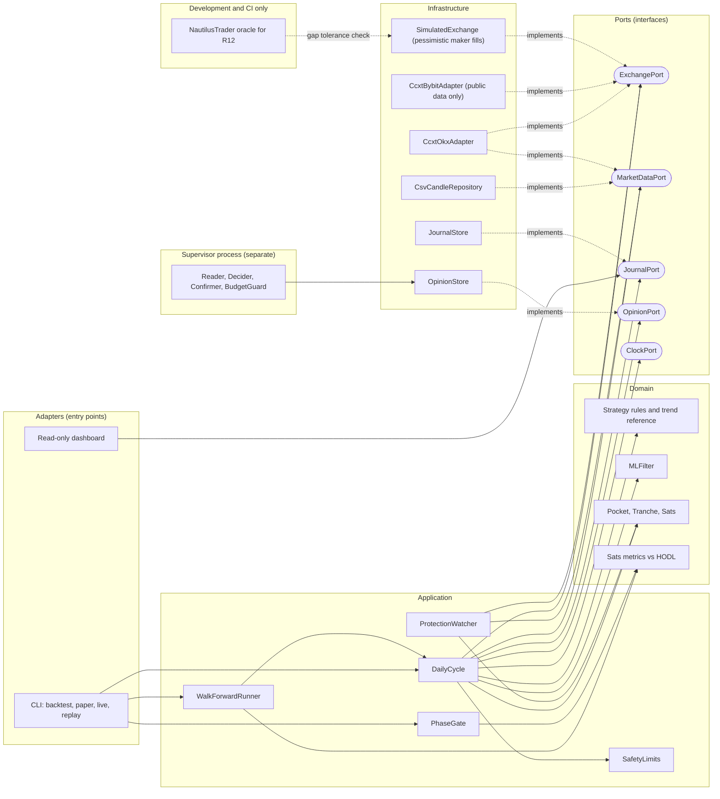

# Component diagram — btc-accumulation — engine, ports and adapters

> **Feature**: BTC sats-accumulation bot (issue #15)
> **Source specs**: requirements R19, R20, R30, R32, R40
> **Related ADRs**: none yet (R40 acts as the decision record)
> **Decisions captured**: R40 own engine with ccxt, NautilusTrader as dev/CI oracle only

## Context

Structure only, layered with the dependency rule (domain never imports infrastructure). One decision
cycle serves backtest, paper and live through interchangeable ports (R32). Layers stay proportional:
the supervisor is a separate process behind a stored opinion, not a new layer.

## Diagram

## Notes

- Everything above `Ports` depends only on ports and the domain: backtest, paper and live differ by the adapter wired in (R32).
- API keys are read only by `CcxtOkxAdapter`, never by `SUP` (R20, R25).
- `SUP` writes only typed opinions to `OpinionStore`, so the engine keeps working if it is down (R39).
- The oracle is replayed in CI only, never imported by production code (R40).
- The legacy `KucoinMarketDataProvider`, `PaperOrderExecutor` and Flask dashboard map to `OKX`/`SIM`/`DASH`, see `docs/architecture/gap-analysis.md`.
