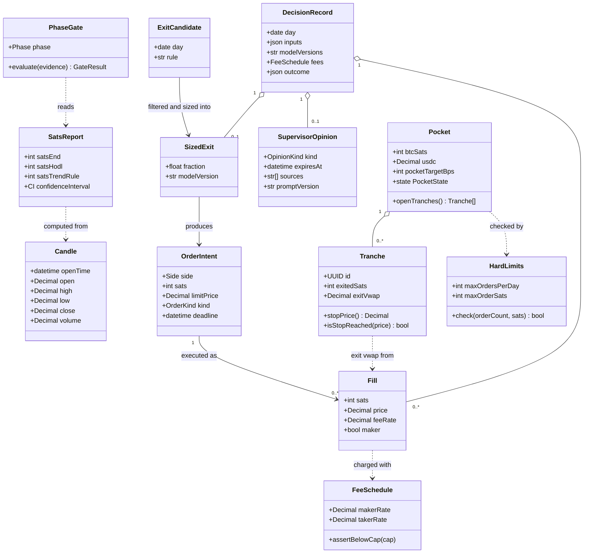

# Class diagram — btc-accumulation — domain model

> **Feature**: BTC sats-accumulation bot (issue #15)
> **Source specs**: requirements R02, R04, R06, R13, R16, R22, R29, R35
> **Related ADRs**: none yet
> **Decisions captured**: results in integer sats, never fiat (R02)

## Context

The domain entities and the ports they cross. Quantities of BTC are integer sats, prices are decimals,
to avoid float error (the legacy code uses `float` everywhere, see the gap analysis). Does not detail
indicator computation nor the LLM client.

## Diagram

## Notes

- `SupervisorOpinion.kind` has no "sell" value by construction: the worst effect is a return to HODL (R22).
- `Tranche.stopPrice()` = `exitVwap` × 1.05 (R16), one per exited tranche including partial exits.
- `SatsReport` holds the HODL and trend-rule baselines beside the result so no figure is shown without them (R02).
- Indicators (RSI, MACD, Bollinger) from the legacy code are inputs of the ML filter (R14), kept as value objects, not part of this model.
