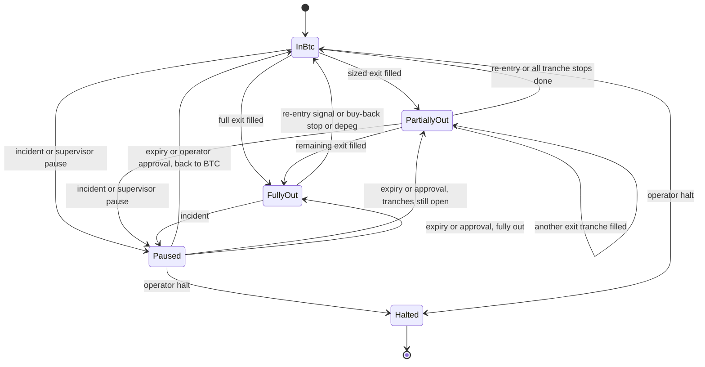

# State diagram — btc-accumulation — pocket position

> **Feature**: BTC sats-accumulation bot (issue #15)
> **Source specs**: requirements R09, R16, R16c, R16d, R37
> **Related ADRs**: none yet
> **Decisions captured**: long BTC or flat in USDC, nothing else (R09)

## Context

Lifecycle of the active pocket's position. Exposure to sats loss exists only out of BTC. Order-level
states are in `05b`, phase-level in `05c`.

## Diagram

## Notes

- `Paused` blocks new exits only. Buy-back stops, depeg buy-back and returns to BTC stay allowed (R16c, R16d).
- A supervisor pause expires automatically (R37), an incident pause needs operator approval (R16c).
- Added in #17 (to validate): leaving `Paused` follows the holdings, so tranche stops stay armed when the pocket is still out of BTC. `Halted` is refused while a tranche is open: the caller returns to BTC first.
- Open: the pause reason (supervisor, which expires, or incident, which needs the operator) is not modelled yet; it comes with the supervisor and protection bricks.
- Decided (owner, 2026-10-23): `Halted` returns the pocket to BTC when it can be done safely, as in R16c.
