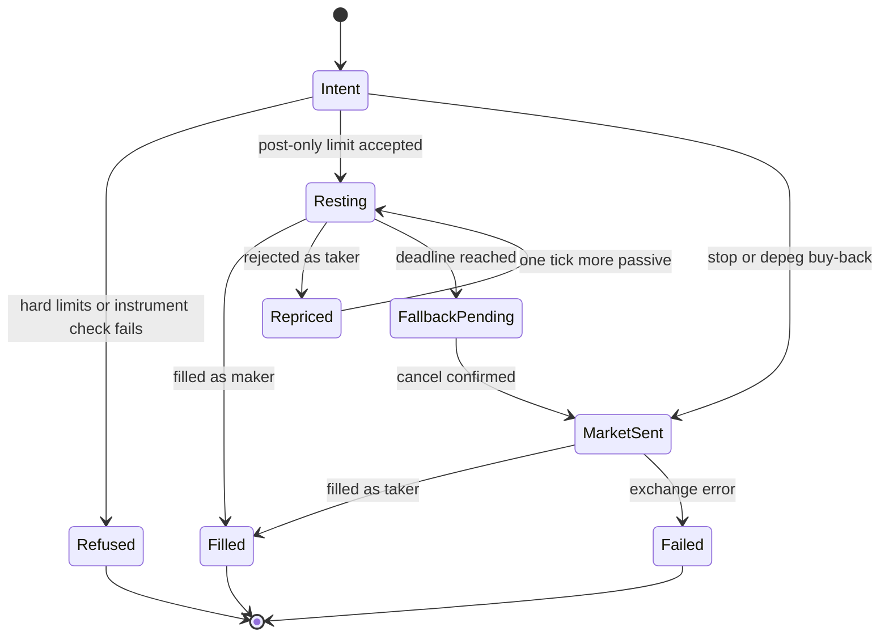

# State diagram — btc-accumulation — order lifecycle

> **Feature**: BTC sats-accumulation bot (issue #15)
> **Source specs**: requirements R06, R17, R18, R33
> **Related ADRs**: none yet
> **Decisions captured**: maker post-only with market fallback after a deadline (R18)

## Context

One order from intent to fill. The buy-back stop (R16) skips the maker phase and goes straight to a
market order. The same lifecycle is simulated pessimistically in backtest (R33).

## Diagram

## Notes

- `Failed` raises an incident (R16c), see `02b`.
- Fees charged: maker or taker rate from the schedule read at start-up (R17).
- Open: the number of repricing attempts before falling back is not in the requirements (to set with the deadline).
