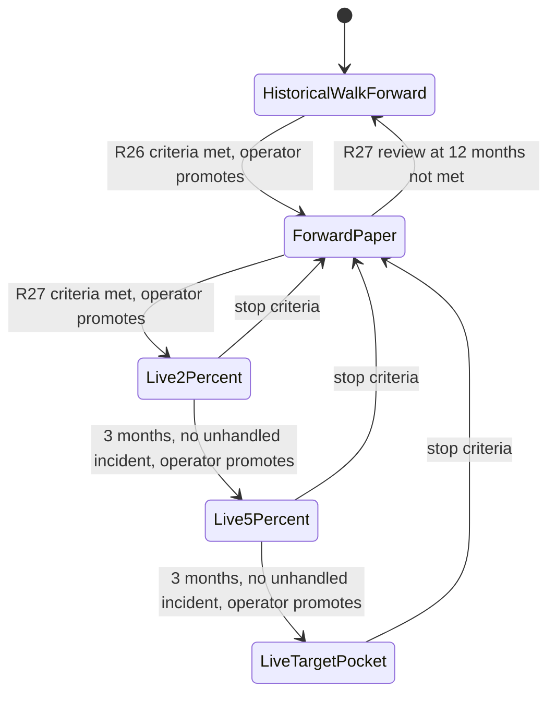

# State diagram — btc-accumulation — proof phase

> **Feature**: BTC sats-accumulation bot (issue #15)
> **Source specs**: requirements R04, R05, R16b, R26, R27, R28
> **Related ADRs**: none yet
> **Decisions captured**: proof before real money, in three phases (R26–R28)

## Context

Which phase the bot is in, and what moves it. Promotion is always an operator decision on evidence
(UC13), demotion to paper follows pre-defined safety criteria, never underperformance (R16b).

## Diagram

## Notes

- Only the pocket allowed by the phase is deposited on the exchange (R05): 2 %, 5 %, then the 10–20 % target (R04).
- Stop criteria (incidents, gap with the replayed backtest) and the "small gap" threshold are still open (requirements, open points).
- The R26 test period is untouched and used once: a failed attempt cannot be retried on the same period.
