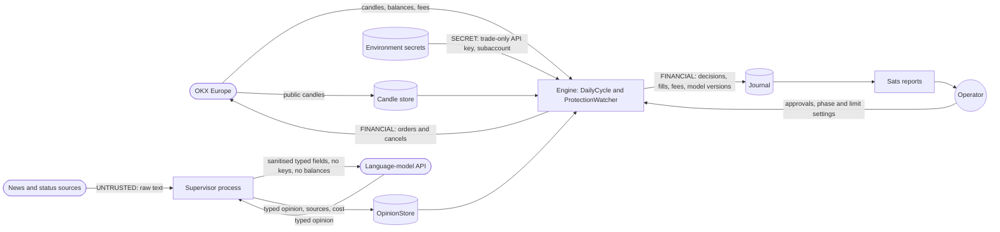

# Data-flow diagram — btc-accumulation — data and sensitive fields

> **Feature**: BTC sats-accumulation bot (issue #15)
> **Source specs**: requirements R20, R24, R25, R29, R36
> **Related ADRs**: none yet
> **Decisions captured**: keys never reach the language model, external text is untrusted

## Context

What data moves where. No personal data of third parties is processed. Sensitive categories here are
`SECRET` (API keys), `FINANCIAL` (balances, orders) and `UNTRUSTED` (external text), each edge is annotated.

## Diagram

## Notes

- No edge carries `SECRET` toward `Supervisor` or `LLM` (R20, R25).
- The supervisor prompt contains no balances: it needs only market and incident context.
- The journal holds financial data, so it stays local and out of git (R29, repository rules).
- Open: where the journal and candle data are stored (files or SQLite) is an implementation choice, not modelled here.
